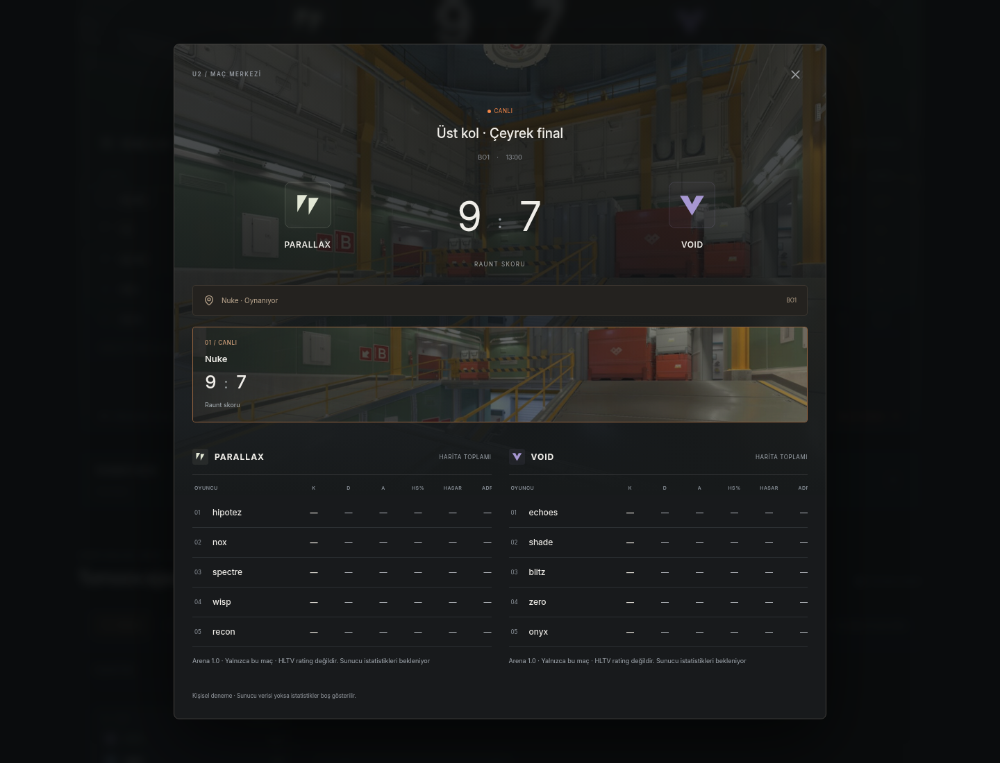
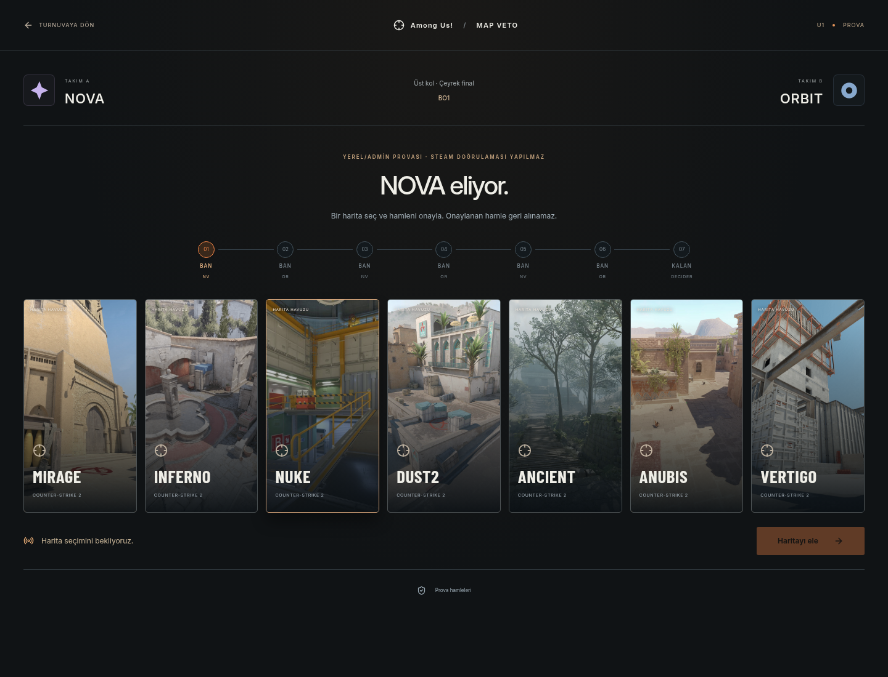
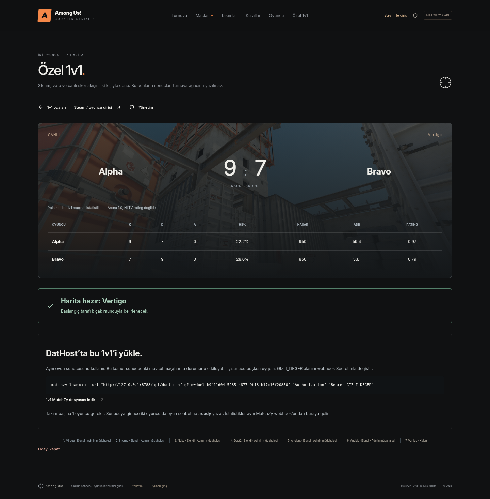
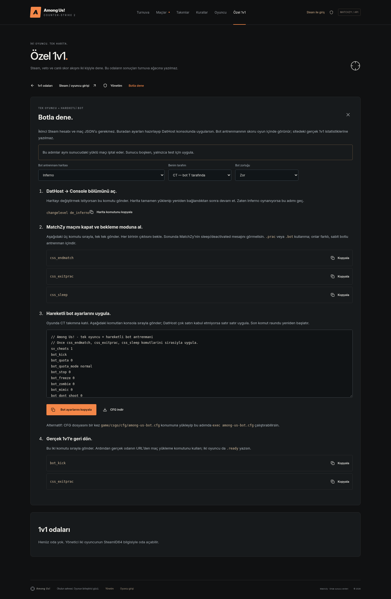

# CS2 Tournament Manager — Among Us! (`kampus-arena`)

A full-featured, web-based **Counter-Strike 2** tournament management, map veto, Steam verification, and live scoreboard platform built for school, campus, and community tournaments — running on **Cloudflare Pages / Workers + D1 SQLite (free tier)**.

> **Zero cloud or server experience required:** Follow the steps below in order to deploy your own CS2 tournament website on Cloudflare for free in about 15–20 minutes.

---

## Table of Contents

- [Key Features](#key-features)
- [Screenshots](#screenshots)
- [How It Works (Architecture)](#how-it-works-architecture)
- [Prerequisites](#prerequisites)
- [Step-by-Step Cloudflare Setup (Beginner Friendly)](#step-by-step-cloudflare-setup-beginner-friendly)
  - [Option A: Deploy with Cloudflare Pages (Recommended)](#option-a-deploy-with-cloudflare-pages-recommended)
  - [Option B: Deploy with Cloudflare Workers (`workers.dev`)](#option-b-deploy-with-cloudflare-workers-workersdev)
  - [How to Generate a Secure Random Secret](#how-to-generate-a-secure-random-secret)
- [Game Server Integration (MatchZy & DatHost)](#game-server-integration-matchzy--dathost)
- [Running Your First Tournament (5-Step Flow)](#running-your-first-tournament-5-step-flow)
- [Troubleshooting & Common Errors](#troubleshooting--common-errors)
- [Local Development & Testing](#local-development--testing)
- [Project Structure & Tech Stack](#project-structure--tech-stack)
- [Additional Documentation (`docs/`)](#additional-documentation-docs)
- [Credits, Open-Source Licenses & Copyright Notice](#credits-open-source-licenses--copyright-notice)

---

## Key Features

- **Double Elimination Tournament Engine:** 8-team Upper Bracket, Lower Bracket, and Grand Final (including optional GF2 bracket reset) with automatic advancement. Supports BO1 (MR12 + MR3 overtime) and BO3 series.
- **Full Turkish / English (`TR | EN`) Localization:** Switch languages anytime from the top bar or full-screen veto header. Both the frontend UI and backend API error/status messages (via the `Accept-Language` header) update immediately and persist in the browser.
- **Steam OpenID Player Verification:** Players sign in with their own Steam accounts without needing a Steam Web API key. Profiles are fetched automatically, and players can only mark **Ready** for their own matches.
- **Real-Time Full-Screen Map Veto (`/#veto/U1`):** Once all 10 verified players across both teams are ready (or an admin force-starts the veto), the standard BO1/BO3 map veto opens. Only the active team's captain can submit moves.
- **Live Scoreboard & Player Stats (MatchZy Webhook):** Receives `round_end`, `map_result`, `series_start`, `series_end`, and `backup_loaded` webhooks from your CS2 server and updates K/D/A, weighted HS%, damage, ADR, and Arena Rating 1.0 every ~5 seconds for all spectators.
- **DatHost Server Controls from Admin Panel:** One-click match loading, pause/unpause, end match, round backup restore, forfeit recording, and replay with a rotated match ID.
- **Private 1v1 Rooms (`/#1v1`) & Solo Bot Training:** Run isolated 2-player rooms to test your setup or host 1v1s without gathering 10 players; includes a **Try with a bot** generator producing copy-ready console commands and `.cfg` files for moving AI bots.
- **Minimal Mode & Browser Trial (`/#dene`):** Clean broadcast/display mode focusing on brackets and one selected active match, plus a local browser-only simulator to test bracket scenarios without touching live data.
- **Full Backup, Atomic Restore & Audit Log:** Download a complete JSON backup of the tournament, validate and atomically restore backups, and inspect the last 100 timestamped admin actions.
- **Security-First Design:** `HttpOnly` + `SameSite=Lax` + `Secure` session cookies, 10-minute brute-force rate limiting on admin logins, CSRF/Origin checks, strict CSP/security headers, and zero leakage of secrets to the browser or backup files.

---

## Screenshots

| Match Center with Map Backdrop | Full-Screen Map Veto |
| :---: | :---: |
|  |  |

| Private 1v1 Room | Solo Bot Training Panel |
| :---: | :---: |
|  |  |

---

## How It Works (Architecture)

```text
  [ Players / Spectators / Admin Browser ]
                      │
                      │ HTTPS (React + TypeScript SPA + TR/EN i18n)
                      ▼
    [ Cloudflare Pages Functions / Workers ]
     ├── /api/arena          → Tournament config, rosters, ready & veto
     ├── /api/matches        → Live scores and player statistics
     ├── /api/auth/*         → Admin login & Steam OpenID flow
     ├── /api/operations     → DatHost controls, health check & backups
     ├── /api/duels          → Private 1v1 rooms
     └── /api/webhooks/matchzy ←── (HTTPS Bearer Webhook) ──┐
                      │                                     │
                      ▼                                     │
      [ Cloudflare D1 (SQLite Database) ]                   │
                                                            │
                      │ (Optional DatHost REST API)         │
                      ▼                                     │
         [ CS2 Server (DatHost + MatchZy) ] ────────────────┘
```

- **No external font or image CDNs:** Fonts (`Inter`, `Barlow Condensed`) and CS2 map images are served locally from `public/`.
- **Dual Cloudflare deployment support:** The same codebase runs natively on both **Cloudflare Pages + Pages Functions** and **Cloudflare Workers (Static Assets)**.

---

## Prerequisites

| Requirement | Required? | Notes |
| --- | --- | --- |
| **GitHub Account** | Yes (Recommended) | Used to connect the repository to Cloudflare for automatic builds and deployments (free). |
| **Cloudflare Account** | Yes | Hosts the frontend, serverless API, and D1 SQLite database (the free tier is more than enough). |
| **CS2 Server + MatchZy** | For live matches | Needed for live scoreboard, forced in-game names, and one-click match loading (e.g., DatHost). Without a game server, brackets, Steam sign-in, map veto, and manual scoring still work completely. |
| **Node.js 22 or 24 LTS** | Local development only | Only needed if you want to edit code or run tests locally. If you deploy via GitHub → Cloudflare, you don't need to install anything on your PC. |

---

## Step-by-Step Cloudflare Setup (Beginner Friendly)

> **Which option should I choose?**
> - If you are starting from scratch, **Option A (Cloudflare Pages)** is the easiest and cleanest path (`https://your-project.pages.dev`).
> - If you already have a `workers.dev` deployment or prefer deploying as a single Worker bundle via Wrangler, use **Option B (Cloudflare Workers)**.

---

### Option A: Deploy with Cloudflare Pages (Recommended)

#### Step 1: Copy the Repository to Your GitHub Account
1. Click **Fork** at the top right of this repository to copy it to your GitHub account (or push the project files to a new repository).
2. Both **Public** and **Private** repositories work with Cloudflare.

#### Step 2: Create a Cloudflare D1 Database
Teams, rosters, Steam verifications, vetoes, sessions, and live match scores are stored in a free **Cloudflare D1** SQLite database.

1. Sign in to the [Cloudflare Dashboard](https://dash.cloudflare.com/).
2. In the left sidebar, go to **Storage & databases → D1 SQL Database**.
3. Click **Create** (or **Create database**).
4. Enter a name such as `kampus-arena`, pick a region close to your players (e.g., **Western Europe** or **Eastern Europe**), and click **Create**.

#### Step 3: Run the 4 SQL Migration Files
Open your newly created `kampus-arena` database and switch to the **Console** tab.

Open each of the **4 SQL files below in order**, copy its entire contents into the SQL Console, and click **Execute**. Wait for **Success** before moving to the next one:

1. [`migrations/0001_matchzy.sql`](migrations/0001_matchzy.sql) — Live match scores and MatchZy map tables
2. [`migrations/0002_management.sql`](migrations/0002_management.sql) — Admin sessions, teams, Steam verifications, and veto tables
3. [`migrations/0003_private_duels.sql`](migrations/0003_private_duels.sql) — Private 1v1 rooms
4. [`migrations/0004_operations.sql`](migrations/0004_operations.sql) — Server lock jobs, audit log, and automatic backups

> **Note:** Every migration uses `CREATE TABLE IF NOT EXISTS`, so running them again will never wipe existing data.

#### Step 4: Create the Cloudflare Pages Project and Connect GitHub
1. In the Cloudflare Dashboard sidebar, go to **Compute (Workers) → Workers & Pages** (or **Workers & Pages**).
2. Click **Create** → switch to the **Pages** tab → choose **Import an existing Git repository (Connect to Git)**.
3. Authorize GitHub and select your repository from Step 1.
4. Configure the build settings exactly as follows:

| Field | Value |
| --- | --- |
| **Project name** | Any name you like (e.g., `school-cs2-cup`) |
| **Production branch** | `main` |
| **Framework preset** | `None` (or `Vite`) |
| **Build command** | `npm run build` |
| **Build output directory** | `dist` |

5. Click **Save and Deploy**.
   - The first build takes a couple of minutes. Once finished, Cloudflare gives you a URL like `https://school-cs2-cup.pages.dev`. Copy this URL!
   - *(Seeing an error or "Local Preview" banner at this point is normal — we haven't connected the database or secrets yet.)*

#### Step 5: Bind the D1 Database (`DB`) to Your Pages Project
This connects your backend API functions to your database:

1. Open your Pages project and go to **Settings → Bindings** (or **Settings → Functions → D1 database bindings**).
2. Click **Add** → **D1 database**.
3. Fill in:
   - **Variable name:** `DB` *(Must be exact uppercase `DB`!)*
   - **D1 database:** Select `kampus-arena` (created in Step 2).
4. Click **Save**. *(If you also use Preview deployments, add the same binding to the Preview environment.)*

#### Step 6: Add Environment Variables and Secrets
In your Pages project, go to **Settings → Variables and Secrets** and click **Add** for each item below:

| Name | Type | Required? | Value |
| --- | --- | --- | --- |
| `PUBLIC_ORIGIN` | **Text** (Plaintext) | **Yes** | Your exact HTTPS site URL, e.g. `https://school-cs2-cup.pages.dev` *(NO trailing `/` and NO `/#admin`!)* |
| `ADMIN_PASSWORD` | **Secret** | **Yes** | Your admin panel password (**at least 12 characters**). |
| `MATCHZY_WEBHOOK_SECRET` | **Secret** | **Yes (for live scores)** | A random shared secret between your CS2 server and site (**at least 24 characters**; no spaces, quotes, `;`, or `\`). |
| `DATHOST_EMAIL` | **Secret** | Optional | Your DatHost account email (for one-click server controls from the admin panel). |
| `DATHOST_PASSWORD` | **Secret** | Optional | Your DatHost account password. |
| `DATHOST_ACCOUNT_EMAIL` | **Secret** | Optional | Only needed if the DatHost server is shared with you from another account (the owner's email). |
| `DATHOST_SERVER_ID` | **Text** | Optional | Your 24-character DatHost server ID *(can also be entered directly in the site's `Admin → Tournament & API` tab)*. |

> **Security Warning:** Never commit Secrets to GitHub, `wrangler.worker.jsonc`, or any `VITE_` variable. Always store them in Cloudflare's **Secret** settings.

#### Step 7: Redeploy and Verify Your Setup
In Cloudflare Pages, new Bindings and Secrets take effect after a **redeploy**:

1. Go to your Pages project's **Deployments** tab.
2. Click the **⋮ (three dots)** menu on the latest deployment and choose **Retry deployment**.
3. Once it finishes with **Success**, verify your deployment:
   - Open `https://YOUR-SITE.pages.dev/api/arena` in your browser:
     - If you see JSON containing `"steamConfigured": true`, **your backend and database are working!**
     - If you see an HTML page instead of JSON, `functions/` was not deployed (make sure you connected GitHub rather than uploading a static ZIP).
     - If you see HTTP `503`, double-check the `DB` binding name and all 4 SQL migrations.
   - Open `https://YOUR-SITE.pages.dev/#admin` and sign in with your `ADMIN_PASSWORD`. You should see **ONLINE ADMIN** (`ÇEVRİMİÇİ YÖNETİM`) at the top!

---

### Option B: Deploy with Cloudflare Workers (`workers.dev`)

If you prefer deploying as a **Cloudflare Worker** instead of Pages:

1. Edit [`wrangler.worker.jsonc`](wrangler.worker.jsonc) in your repository and update:
   - `"name"`: Your Worker name
   - `"PUBLIC_ORIGIN"`: Your `https://...workers.dev` (or custom domain) URL
2. In Cloudflare Dashboard → **Workers & Pages → Create → Workers → Connect to Git** (or your existing Worker's **Settings → Build**):
   - **Build command:** `npm run build`
   - **Deploy command:** `npm run deploy:worker`
   - **Root directory:** Repository root (leave blank)
3. Bind your D1 database as `DB` under **Bindings** and run all 4 SQL migrations (`0001`–`0004`) in the D1 Console.
4. Add `PUBLIC_ORIGIN`, `ADMIN_PASSWORD`, `MATCHZY_WEBHOOK_SECRET` (and optional DatHost secrets) under **Settings → Variables and Secrets**, then trigger a deploy.

See [docs/WORKERS.md](docs/WORKERS.md) for additional Worker details.

> **Note on Static ZIP Uploads:** Running `npm run package:test` builds `artifacts/kampus-arena-test.zip` for quick UI-only previews. Static ZIP uploads do **not** include Cloudflare Functions or D1, so Steam login, shared veto, and live scores will not work. Always use GitHub-connected Pages (Option A) or Workers (Option B) for real tournaments.

---

### How to Generate a Secure Random Secret

You can generate a strong `MATCHZY_WEBHOOK_SECRET` (24+ characters) locally using either command:

- **Windows (PowerShell):**
  ```powershell
  -join ((48..57 + 65..90 + 97..122) | Get-Random -Count 40 | ForEach-Object {[char]$_})
  ```
- **macOS / Linux / Git Bash:**
  ```bash
  openssl rand -hex 24
  ```

---

## Game Server Integration (MatchZy & DatHost)

The bracket, Steam verification, and map veto work on Cloudflare alone. To connect a live CS2 server for **automatic match loading, forced player names, and real-time scoreboards**:

1. **Install MatchZy on Your CS2 Server:** Make sure Metamod:Source, CounterStrikeSharp (compatible with your MatchZy release), and [MatchZy](https://github.com/shobhit-pathak/MatchZy) are installed. Verify in the server console with `meta list` and `css_plugins list`.
2. **Configure the Remote Log Webhook:** Add the following lines to `game/csgo/cfg/MatchZy/config_override.cfg` on your game server (template: [`config/matchzy/config_override.cfg.example`](config/matchzy/config_override.cfg.example)):

```text
matchzy_remote_log_url "https://YOUR-SITE.pages.dev/api/webhooks/matchzy"
matchzy_remote_log_header_key "Authorization"
matchzy_remote_log_header_value "Bearer YOUR_WEBHOOK_SECRET"
matchzy_ready_mode 0
matchzy_time_to_start 0
```

> Keep the **single space** after `Bearer `. `YOUR_WEBHOOK_SECRET` must exactly match `MATCHZY_WEBHOOK_SECRET` in Cloudflare. Restart the CS2 server after saving.

3. **One-Click Match Loading via DatHost (Recommended):**
   - Add `DATHOST_EMAIL` and `DATHOST_PASSWORD` as Cloudflare Secrets.
   - In the website's **Admin → Tournament & API** tab, enter your **Server connection address (`host:port`)** and **24-character DatHost server ID**, save, and click **System & Backup → Test DatHost connection**.
   - Once a match's veto finishes, go to **Admin → Match management → `<match>` → Server → Load match on server**.
4. **Manual Alternative (Without DatHost API):**
   - After veto completes, run this command in your CS2 server console (e.g., for match `U1`):
   ```text
   matchzy_loadmatch_url "https://YOUR-SITE.pages.dev/api/match-config?match=U1" "Authorization" "Bearer YOUR_WEBHOOK_SECRET"
   ```
5. **In-Game Ready Flow:** Marking **Ready** on the website only triggers the map veto. Once the match is loaded on the CS2 server, players join the server and type `.ready` in game chat. After the knife round, the winning team chooses sides with `.stay` or `.switch`.

---

## Running Your First Tournament (5-Step Flow)

1. **Sign In as Admin (`/#admin`):** Log in with `ADMIN_PASSWORD`. Open **System & Backup** and verify that D1, SQL tables, Steam, and Webhook all show ready/configured.
2. **Set Up Teams & Rosters:**
   - Have players visit the site and sign in via **Guest → Sign in with Steam** in the top-left account menu.
   - Open **Admin → Teams & Players**, configure team names, short tags, logos, and captains, click **Add player** to pick verified Steam accounts, and click **Save changes**.
3. **Choose Opening Matchups:** Open **Admin → Match management** and assign `U1`–`U4` teams in the **Opening round matchups** section, then save.
4. **Ready Check & Map Veto:** When all 5 players on both teams click **Ready** on `/#oyuncu`, the full-screen veto (`/#veto/U1`) launches automatically. *(For smaller rosters or testing, admins can use **Force-start real veto**.)*
5. **Load & Track Live:** Load the match onto your CS2 server. Starting from round 1, live scores, map breakdowns, and player stats update automatically, and winners/losers advance through the bracket upon completion.

---

## Troubleshooting & Common Errors

| Symptom | Likely Cause & Fix |
| --- | --- |
| `/api/arena` returns HTML instead of JSON | Deployed as a static ZIP or wrong deploy command. Use GitHub-connected Pages (`dist` + `functions/`) or `npm run deploy:worker` for Workers. |
| `/api/arena` or `/api/matches` returns `503` | Missing `DB` D1 binding, missing SQL migrations (`0001`–`0004`), or forgot to **Retry deployment** after adding settings. |
| Steam sign-in fails or redirects to the wrong URL | `PUBLIC_ORIGIN` does not exactly match your live `https://...` origin (remove any trailing `/` or `/#admin` and redeploy). |
| `Variables cannot be added to a Worker that only has static assets` | Worker deploy command is uploading static files only instead of running `npm run deploy:worker` with `wrangler.worker.jsonc`. |
| Match loads on server, but no live scores appear on site | Mismatch in `config_override.cfg` URL, `Bearer <SECRET>` formatting, or Cloudflare `MATCHZY_WEBHOOK_SECRET`. |
| `Unknown command: matchzy_loadmatch_url` | MatchZy is not loaded on the CS2 server. Check `css_plugins list` and CounterStrikeSharp version compatibility. |
| Admin page says **"LOCAL PREVIEW"** | Browser cannot reach the online `/api/arena` endpoint. Check `/api/arena` response and D1 setup. |

---

## Local Development & Testing

Local development requires **Node.js 22 or 24 LTS**:

```bash
# 1. Install dependencies
npm ci

# 2. Start the Vite frontend dev server
npm run dev
```

### Full-Stack Local Testing with Wrangler + Local D1
To run the full API and a local SQLite D1 database without touching production, create a `.dev.vars` file in the project root (ignored by Git):

```env
PUBLIC_ORIGIN="http://localhost:8787"
ADMIN_PASSWORD="at-least-12-chars-local-password"
MATCHZY_WEBHOOK_SECRET="at-least-24-chars-local-webhook-secret"
```

Then run:

```bash
npm run build
npx wrangler d1 migrations apply DB --local --config wrangler.worker.jsonc
npm run dev:worker
```

### Build & Automated Test Commands

```bash
# TypeScript check and production frontend build (dist/)
npm run build

# Verify Cloudflare Pages Functions and Worker bundles
npm run build:functions
npm run build:worker

# Run 97 unit & integration tests (bracket engine, D1 SQLite, MatchZy, DatHost, Steam, security, i18n)
npm test

# Run Playwright E2E tests (desktop + 390px mobile)
npx playwright install chromium
npm run test:e2e
```

> To use an already-installed Chrome/Chromium binary, set `PLAYWRIGHT_CHROMIUM_EXECUTABLE_PATH` to its executable path.

---

## Project Structure & Tech Stack

**Tech Stack:** React 19 · TypeScript 5.9 · Vite 6 · Cloudflare Pages Functions / Workers · Cloudflare D1 (SQLite) · Lucide React · Playwright · Node Test Runner (`tsx`)

```text
├── src/                  # React + TypeScript frontend SPA
│   ├── i18n/             # TR/EN localization provider, dictionaries & server message translator
│   ├── tournament/       # Double-elimination engine, MR12/MR3 validation & live feed hooks
│   ├── arena/            # API client, veto, 1v1, bot training & operations models
│   ├── components/       # Bracket, scoreboard, account menu, admin & operations UI
│   └── pages/            # Home, Matches, Teams, Results, Rules, Veto, Player, 1v1, Admin
├── functions/api/        # Cloudflare Pages Functions API endpoints
├── server/               # Shared backend logic (D1, Steam OpenID, DatHost, MatchZy, i18n, worker.ts)
├── migrations/           # Ordered Cloudflare D1 SQL migrations (0001–0004)
├── public/               # Static assets (_headers security policy, local fonts, CS2 map images)
├── config/matchzy/       # Example MatchZy server configuration
├── tests/                # Unit & D1/Worker integration tests (97 tests)
├── e2e/                  # Playwright end-to-end tests (desktop + mobile)
└── docs/                 # Detailed topic-specific operations and setup guides
```

---

## Additional Documentation (`docs/`)

- [Admin Panel, Steam Sign-In & Map Veto Guide](docs/ADMIN.md) *(TR)*
- [Operations, DatHost Server Controls & Full Backup Guide](docs/OPERATIONS.md) *(TR)*
- [Live CS2 Match Setup with DatHost](docs/LIVE-SERVER.md) *(TR)*
- [MatchZy Webhook & Live Stats Architecture](docs/MATCHZY.md) *(TR)*
- [Cloudflare Workers (`workers.dev`) Setup Guide](docs/WORKERS.md) *(TR)*
- [Private 1v1 Rooms & Solo Bot Training Guide](docs/1V1.md) *(TR)*
- [User Roles & Access Boundaries](docs/ROLES.md) *(TR)*
- [Static Online Preview (ZIP) Guide](docs/ONLINE-TEST.md) *(TR)*

---

## Credits, Open-Source Licenses & Copyright Notice

This project builds upon the work of open-source maintainers and community creators. Huge thanks to everyone behind these projects:

### Community Projects & Assets Used

- **[MatchZy](https://github.com/shobhit-pathak/MatchZy)** (`shobhit-pathak/MatchZy`, GPL-3.0) — CS2 match management, ready/knife flow, and remote log webhook event schema (`Events.cs`, `MatchData.cs`, `RemoteLogConfig.cs`) power the live scoreboard integration.
- **[CounterStrikeSharp](https://github.com/roflmuffin/CounterStrikeSharp)** & **Metamod:Source** — Server-side CS2 plugin runtime ecosystem.
- **[GhostCap Gaming — CS2 Map Images](https://github.com/ghostcap-gaming/cs2-map-images)** — Map backdrop screenshots in `public/maps/` (Mirage, Inferno, Nuke, Dust2, Ancient, Anubis, Vertigo) shared by GhostCap Gaming for CS2 community projects. Full attribution details: [`public/maps/SOURCES.md`](public/maps/SOURCES.md).
- **Fonts (SIL Open Font License 1.1):**
  - **[Inter](https://github.com/rsms/inter)** — Copyright © 2016 The Inter Project Authors. License: [`public/fonts/Inter-LICENSE.txt`](public/fonts/Inter-LICENSE.txt).
  - **[Barlow Condensed](https://github.com/jpt/barlow)** — Copyright © 2017 The Barlow Project Authors. License: [`public/fonts/BarlowCondensed-LICENSE.txt`](public/fonts/BarlowCondensed-LICENSE.txt).

### Open-Source Libraries & Tooling

- **[React](https://react.dev/)** (MIT) — UI library
- **[Vite](https://vite.dev/)** (MIT) — Frontend build tool & dev server
- **[TypeScript](https://www.typescriptlang.org/)** (Apache-2.0) — Typed JavaScript
- **[Lucide React](https://lucide.dev/)** (ISC) — UI icons
- **[fflate](https://github.com/101arrowz/fflate)** (MIT) — Static test ZIP packaging
- **[Playwright](https://playwright.dev/)** (Apache-2.0) — End-to-end browser testing
- **[tsx](https://github.com/privatenumber/tsx)** (MIT) — TypeScript execution for Node tests
- **[Cloudflare Wrangler](https://github.com/cloudflare/workers-sdk)** (MIT / Apache-2.0) — Cloudflare Pages, Workers, and D1 tooling

### Trademark & Copyright Disclaimer

- **Counter-Strike**, **Counter-Strike 2 (CS2)**, **Steam**, Steam logos, and all related game assets are trademarks and property of **Valve Corporation**. This project is not affiliated with, endorsed by, or sponsored by Valve Corporation.
- **HLTV** is a trademark of **HLTV.org**. The **Arena Rating 1.0** metric shown in this application is an open community formula based solely on in-match kills, ADR, and survival rate; it is not HLTV.org's official rating formula.
- **Cloudflare**, **Cloudflare Pages**, **Cloudflare Workers**, **Cloudflare D1**, and **DatHost** are trademarks of their respective owners.
- All third-party fonts, assets, and libraries remain subject to their respective copyrights and open-source licenses (SIL OFL 1.1, MIT, ISC, Apache-2.0, GPL-3.0).
