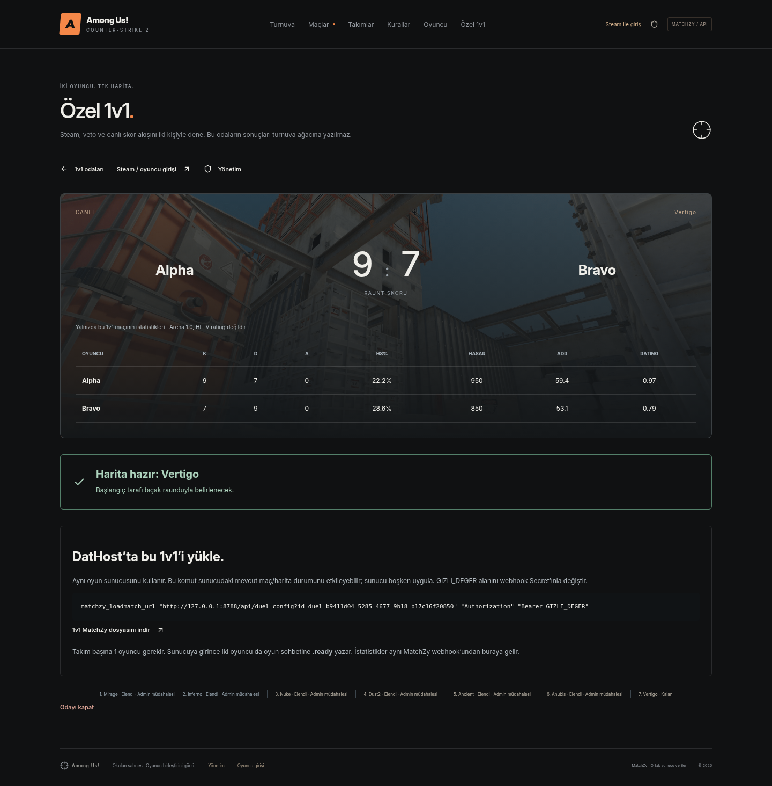

# Private 1v1 Rooms & Solo Bot Training

The Private 1v1 page lives at `/#1v1` (**Private 1v1** in the main menu). Admins can open isolated 2-player rooms with two SteamID64s without adding teams to the tournament bracket. Players, vetoes, match IDs, and live stats are completely separate from the tournament.

## One-Time Database Migration

Requires your existing Steam/admin/MatchZy setup plus [`migrations/0003_private_duels.sql`](../migrations/0003_private_duels.sql) applied on the D1 database bound as `DB`. This does not affect existing tournament tables.

## Create & Run a 1v1 Room

1. Sign in as admin at `/#admin`.
2. Open **Private 1v1** (`/#1v1`).
3. Enter display names and two distinct SteamID64s, then click **Create 1v1 room**.
4. Both players sign in with Steam, open the room from **My rooms** (or the invite link `/#1v1/duel-...`), and click **Ready** (valid for 30 minutes).
5. At 2/2 ready, the BO1 map veto opens (6 alternating bans, last map played).
6. Load the match via the room's **Load match on server** button (DatHost API) or copy the `matchzy_loadmatch_url` command into the CS2 server console.
7. Both players join the server and type `.ready` in chat. MatchZy configures `players_per_team: 1`, `min_players_to_ready: 1`, `num_maps: 1`, and `skip_veto: true`.
8. Live round scores, K/D/A, HS%, damage, ADR, and Arena Rating update inside this room only.

## Bypassing Ready Checks (Admin)

To test the veto and match config without waiting for both players, click **Bypass ready check, start veto** and confirm. Admins can submit veto moves on behalf of either player (logged in the move history).

## Solo Training with a Moving Bot

Signed-in admins see **Try with a bot** on `/#1v1`. Choose a map, your side (CT/T), and bot difficulty (`Easy`–`Expert`) — no second SteamID or match JSON is needed. The panel generates copy-ready DatHost console commands and a downloadable `among-us-bot.cfg`:

1. Send `changelevel` if switching maps and wait for reload.
2. Run `css_endmatch`, `css_exitprac`, `css_sleep` one by one to put MatchZy into sleep mode.
3. Join your side in-game and apply the bot config commands (or upload `game/csgo/cfg/among-us-bot.cfg` once and run `exec among-us-bot.cfg`).
4. When returning to real 1v1s, run `bot_kick` and `css_exitprac`, then load a real room's match config.

Bot training scores appear in-game only and are never written to real 1v1 stats.

## Troubleshooting 1v1 Webhooks

- `A match is already setup ... cannot load a new match`: Another match is loaded on the server. Run `css_endmatch` in the server console when safe, then load the new room.
- Match config loads (`Received match config`), but `SendEventAsync ... Unauthorized` appears: Verify `matchzy_remote_log_header_value "Bearer YOUR_WEBHOOK_SECRET"` in `game/csgo/cfg/MatchZy/config_override.cfg` matches Cloudflare's `MATCHZY_WEBHOOK_SECRET`.
- Closing a room in the UI stops accepting new moves/webhooks for that room while keeping recorded scores visible. It does not send a remote stop command to the CS2 server.
